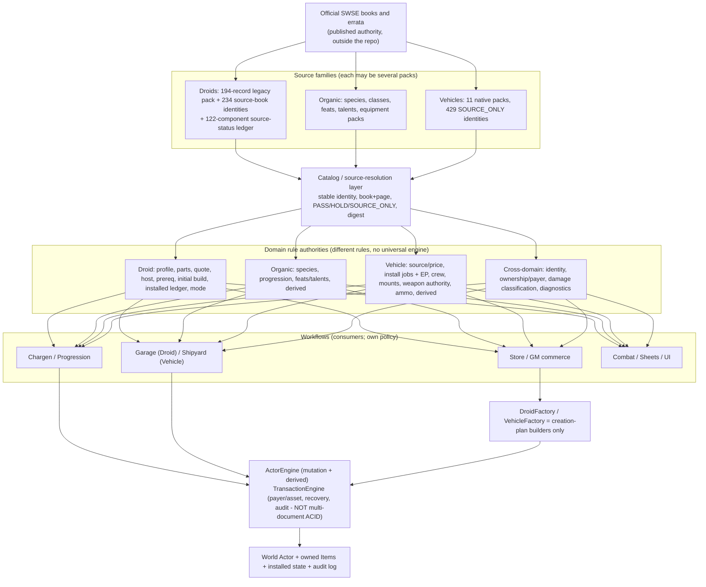

# SWSE V2 - Single-Source-of-Truth Master Architecture Map

| | |
|---|---|
| **Repo** | `docflowGM/foundryvtt-swse` |
| **Scope** | READ-ONLY audit/design. No production JS, packs, data, templates, tests, workflows or `system.json` were changed. Only these three Markdown files were added. |
| **Observed HEADs** | Working checkout / PR #1117 `feature/v2-unified-clean-break-convergence` = `1d09d4203be7a9ed72b157b1fb1dc3b40bea0b42` (verified `git rev-parse` and `origin`); PR #1116 `202082309628ea2c6088e5806ab03a08b7ed77fd`; Vehicle PR #1092 `audit/universal-vehicles-phase1` = `e844aba1bbbb9b2a66f860bf579cf476d43c40f7` (verified an **ancestor** of the #1117 head); `integration/v2-vehicles-droids-2026-11` = `8ad8ca41e69cd658601c44a68622160e63fb17cb`; `origin/main` = `de196e5a4...` ("Merge pull request #1109 from .../integration/v2-vehicles-droids-2026-11"). |
| **Date/time** | 2026-11-06 (UTC), commit time of observed head 17:02:46Z |
| **Evidence level** | `CODE_VERIFIED` (files read at the observed SHA) and `TEST_REPRODUCED` (commands rerun in this session, listed in the Ledger). No claim is `RUNTIME_CONFIRMED`. |
| **Foundry status** | **Not Foundry-tested.** Node shims and GitHub CI are not Foundry v13 acceptance. |
| **Not available to me** | The owner's hand-drawn sketch image (interpreted from the command's text), and any printed rulebook PDF/TXT (none exist in this environment: only `assets/pdf/swse-character-sheet-fillable.pdf`). **No rule in these documents is independently verified against a printed page by me**; rule citations are inherited from the owner's input audit and the repo's own ledgers and are marked as inherited. |
| **Siblings** | [Consumer Ledger](SWSE_V2_SSOT_5_Category_Consumer_Ledger.md) - [Convergence Roadmap](SWSE_V2_SSOT_Convergence_Roadmap_for_Claude.md) |

**Audit/change ledger:** 2026-11-06 initial version; supersedes nothing; the earlier U-0 audit (`docs/audits/droids/droid-v2-u0-convergence-audit.md`) and the owner's five-category audit are *inputs*, not truth.

---

## 1. North-star map (one page)



ASCII equivalent:

```
BOOKS -> {Droid packs | Organic packs | Vehicle packs} -> catalog/source resolution
      -> domain authorities (Droid | Organic | Vehicle | cross-domain)
      -> workflows (Chargen | Garage/Shipyard | Store | Combat/Sheet)
      -> [Factories build CREATE plans] -> ActorEngine + TransactionEngine -> World state
```

### Corrections to the owner's sketch

| Sketch element | Correction | Evidence |
|---|---|---|
| DroidFactory central, reached from every droid operation | DroidFactory only builds a **creation mutation plan** (Store purchase of a whole stock/custom droid). Garage, Chargen and Store-components consume the **shared catalog/quote/source/ledger authorities** and never call DroidFactory. | `scripts/engine/droids/droid-factory.js` header: "Never mutate actor / never assign ownership"; Garage calls `DroidCustomizationEngine`, chargen calls `applyInitialInstallationToPlan`. |
| One physical pack per family | Not required. Droids already have a legacy pack + canonical JSON source-books; Vehicles have **11** native packs (`universal-vehicle-pack-registry.js`). The authority is the *source-resolution layer*, not a pack. | pack registry; `data/canonical/droids/source-books/*.json` (10 files). |
| One universal factory / installation engine | Droid and Vehicle rules differ materially (see Section 6). Share *identity, provenance, payer/asset separation, policy gates, failure reporting*; do not share installation logic. | Droid ledger = `system.installedSystems`; Vehicle ledger = sealed `flags.swse.vehicleInstallations`. Same word, different meaning. |
| Arrow "Garage -> Factory" | Garage mutates an **existing** Actor through `TransactionEngine.executeAssetCustomizationTransaction` + `ActorEngine`. | `droid-customization-engine.js` apply path. |
| Organic characters implicit | Organic PCs are a third source family and the **funding/progression source** for droids, followers and vehicles; scoped here as *interfaces and reuse* only. | Section 3, workflow 1. |

## 2. Source families and pack registry (verified at 1d09d42)

| Family | Physical source | Count verified | Status vocabulary | Notes |
|---|---|---|---|---|
| Droid models (legacy) | `packs/droids.db` | **194** lines (rerun) | listing/statblock+price only | Still read by Store: `scripts/engine/store/store-constants.js:51` (`DROIDS`), `loader.js:312,358`, `index.js:84`. |
| Droid models (canonical identity) | `data/canonical/droids/source-books/{clone,core,force,gaw,goi,kotor,legacy,rebellion,scum,sgd}.json` | **234** entries, **all** `mechanicalStatus=partial`, `runtimeStatus=not-tested` (rerun script) | source-reviewed identity; 0 mechanically certified | Entries such as R2 carry `systems: {}`: factory configuration is not in the data. |
| Droid components | generated 122-identity source-review ledger | **99 PASS / 23 HOLD** (inherited; not recounted by me) | PASS/HOLD | `droid-component-source-review.js`. |
| Vehicles | 11 native packs (`vehicles-airspeeders`, `-capital-ships`, `-space-transports`, `-speeders`, `-starfighters`, `-starships`, `-stations`, `-tracked`, `-walkers`, `-weapon-emplacements`, `-wheeled`) | registry lists 11; **429** identities (inherited; vehicle validators below passed) | `SOURCE_ONLY`, digest-bound | `scripts/domain/vehicles/universal-vehicle-pack-registry.js`. |
| Organic | species/class/feat/talent/equipment packs | not enumerated in this audit | n/a | Out of depth for this pass (interfaces only). |

## 3. The three authority layers

1. **Published/catalog layer** - says what a game concept *is*: identity, book/page, variant, PASS/HOLD/SOURCE_ONLY, digest. Read-only at runtime.
2. **Rule/eligibility layer** - pure functions answering "may this be bought/fitted/used, at what quote?" Domain-specific. No writes.
3. **Instance layer** - what *this* Actor owns/has installed. Written only by one named writer per domain through ActorEngine (and TransactionEngine when credits move). Display mirrors, embedded Items, drafts, imported statblocks and installed components are **not equivalent evidence** (Droid rule, now enforced by code and tests).

## 4. Exact existing C1 modules (keep/strengthen)

| Concern | Module (observed) | Contract |
|---|---|---|
| Droid identity | `scripts/domain/droids/droid-rules-profile.js` | independent dimensions (foundryType, droidRules, follower, calculationMode, confidence); contradiction fails closed; `componentMayContributeDroidModifiers` = confirmed ledger only |
| Droid source clearance | `droid-component-source-review.js` | PASS/HOLD; locomotion HOLD subsets only for first unrestricted INITIAL_BUILD |
| Droid quote | `droid-component-quote-authority.js` | exact size/variant; no ranges parsed as money |
| Droid eligibility | `droid-installation-eligibility.js` | ELIGIBLE/BLOCKED/UNKNOWN; `HOST_RULING_PENDING` |
| Droid installed read model | `droid-installed-component-resolver.js` | multi-source read; `primarySource.kind` says which evidence decided |
| Droid appendage identity | `droid-appendage-instance.js` | opaque instance ids; no parsing of ledger keys |
| Droid initial install | `droid-initial-installation-service.js` | creation grant, deterministic ids, all-or-nothing |
| Droid writer | `scripts/engine/customization/droid-customization-engine.js` | only post-creation writer of `system.installedSystems`; removal/resale only from confirmed ledger |
| Droid mode | `scripts/actors/droid/droid-mode-adapter.js` | stock-statblock vs playable-derived; component suppression |
| Vehicle source | `vehicle-source-identity.js`, `vehicle-runtime-contract.js`, `vehicle-pack-data-loader.js` | immutable digest-bound source; fail-closed catalog |
| Vehicle installation | `vehicle-installation-ledger.js`, `vehicle-modification-rules.js`, `scripts/engine/vehicles/vehicle-installation-service.js` | sealed `flags.swse.vehicleInstallations`, EP/time/Mechanics, refund per printed rule |
| Vehicle attack | `vehicle-attack-preflight.js`, `vehicle-stock-attack-authority.js`, `vehicle-weapon-damage.js` | trust derived at use; refuse before costs |
| Shared mutation | `scripts/governance/actor-engine/actor-engine.js` | governed writes; not pricing/citation |
| Shared commerce | `scripts/engine/store/transaction-engine.js` | payer != asset supported; recovery; **not multi-document ACID** |
| Shared ownership | `scripts/engine/store/acquisition-service.js` | `system.relationships` owner links on purchase |

## 5. Data/state ownership

| State | Owner | Writer | Reader(s) |
|---|---|---|---|
| Droid installed hardware | `system.installedSystems` (droid) | `DroidCustomizationEngine`; creation seed (`droid-initial-installation-service.js`) | resolver, ModifierEngine, prerequisites, Garage, sheet |
| Droid draft / display mirror | `system.droidSystems` | same writers (mirror) ; stock importer (snapshot) | sheet, builder; **never authorizes** |
| Vehicle installed mods | `flags.swse.vehicleInstallations` (sealed) | `VehicleInstallationService` only | weapon authority, effects, sheet |
| Vehicle published baseline | `flags.swse.universalVehicleSource.source` | import/factory at creation; guarded migration | classifier, preflight, sheet |
| Vehicle **legacy** `system.installedSystems` | **legacy Upgrade/Bay lane** | `UpgradeService` (unpaid), `VehicleCustomizationEngine` (paid, non-canonical) | `ModifierEngine._getVehicleModModifiers` |
| Credits | wallet Actor `system.credits` | `TransactionEngine` | all |
| Ownership | `system.relationships` | `StoreAcquisitionService` | sheets, GM tools |

## 6. Exceptions where workflow semantics must differ (do not unify)

| Topic | Droid | Vehicle |
|---|---|---|
| Installed-state meaning | physical body hardware, instances, hosts (appendages) | aftermarket modifications on a hull, EP/workforce/time |
| Creation grant vs paid install | chargen/follower grant is not a retail purchase | published new/used price; custom construction project |
| Refund on removal | Garage: one-half (per code) | Shipyard: one-quarter (inherited rule, `planVehicleUninstall`) |
| Stock suppression | stock-statblock mode withholds baked bonuses | immutable published baseline + mutable aftermarket |
| Source trust | PASS/HOLD per component | `SOURCE_ONLY`, attack trust derived at use, GM receipt |

## 7. Twelve lifecycle maps

Legend: **P**=proven in code at observed SHA, **T**=proven by a test I reran, **?**=unproven edge. "Pack" -> "resolver" -> "rule" -> "entry" -> "plan" -> "mutation/commerce" -> "World state" -> "UI".

| # | Workflow | Source pack | Resolver | Rule/eligibility | Entry point | Plan | Authoritative mutation/commerce | Resulting state | Visible UI | Unproven edges |
|---|---|---|---|---|---|---|---|---|---|---|
| 1 | Organic creation / level-up | species/class/feat packs | progression framework | prerequisite checker | `ChargenShell`/`LevelupShell` | progression session | progression finalizer -> ActorEngine | character Actor | shell | **not traced in this audit** (interfaces only) |
| 2 | Droid PC creation | `data/droid-systems.js` via `data/droid-part-schema.js` | `resolveDroidComponentSourceReview` | typed prereqs, builder quote (INITIAL_BUILD) | `DroidBuilderStep` | `applyInitialInstallationToPlan` | ActorEngine plan; no debit | `droid` Actor: ledger + mirror | Droid sheet | live chargen end-to-end ? |
| 3 | Droid follower creation | same | same | same + follower categories | `FollowerDroidBuilderStep` (extends `DroidBuilderStep`) | `resolveFollowerDroidInstallation` | `runFollowerMutationTransaction` | `npc` Actor with explicit droid signals + ledger | NPC sheet | two-Actor commit in V13 ? |
| 4 | Published stock Droid import | canonical statblock/legacy record | `StockDroidNormalizer` | n/a | import wizard / Store | `StockDroidImporterEngine` | ActorEngine | stock-statblock `droid`, ledger empty | sheet | factory equipment unknowable (0/234) |
| 5 | Droid component buy/fit/remove/resell | components catalog | source review + quote | eligibility; confirmed-ledger removal | `CustomizationBayApp` (garage) | `normalizeDroidCustomizationChangeSet` | `TransactionEngine.executeAssetCustomizationTransaction` | ledger+mirror+Items | Bay | follower wallet via hotfix proxy ? |
| 6 | Whole Droid Store purchase | legacy `droids` pack | `loader.js` | store policy | Store checkout | `DroidFactory.buildMutationPlan` | checkout transaction | `droid` Actor (stock-statblock) | Store | price source = listing `finalCost`, not components (F6) |
| 7 | Native Vehicle purchase/import | 11 native packs | `VehiclePackDataLoader` | `evaluateVehiclePurchase` | Store / import wizard | `VehicleFactory` / `VehicleImportEngine` | TransactionEngine + StoreAcquisition | `vehicle` Actor, sealed source | Vehicle sheet | live readback ? |
| 8 | Vehicle creation / custom hull | stock-frames table | `custom-vehicle-construction*` | construction rules | `construction-designer-ui.js` | construction project | `custom-vehicle-construction-service.js` | custom vehicle + construction record | designer | policy for unpublished hulls not owner-ruled |
| 9 | Shipyard start/work/check/install/uninstall | modification catalog | `vehicle-modification-rules` | EP, nonstandard, crew | vehicle sheet `bindShipyardActions` | job plan | `VehicleInstallationService` + TransactionEngine | `flags.swse.vehicleInstallations` + managed weapon Items | Vehicle sheet | live ? |
| 10 | Generic Upgrade UI changes a Vehicle | n/a | n/a | **none** | `CommandBus` `APPLY_ITEM_UPGRADE` -> `UpgradeCommands` -> `UpgradeService.applyUpgrade` | n/a | **`ActorEngine.applyMutationPlan` raw write, no payment** | `system.installedSystems[upgradeId]=true` | Upgrade surface (UI reachability **?**) | See Ledger V-25 |
| 11 | Vehicle attack | source group / sealed install | `resolveVehicleWeaponAuthority` | preflight, crew, arc | sheet weapon ops | n/a | roll path after `authorizeVehicleAttackBeforeCosts` | chat/ammo | sheet | live ? |
| 12 | Failed two-Actor wallet transaction | n/a | n/a | n/a | any asset transaction | snapshot | `TransactionEngine` restore/verify | rolled back or **explicit unresolved status** | notifications | partial failure injection in V13 ? |

## 8. Contract invariants

1. A source identity, display mirror, embedded Item, draft or imported statblock never authorizes a sale, modifier or prerequisite; only the domain's confirmed installed record does (Droid: ledger; Vehicle: sealed flag).
2. Unknown (price, SR, arc, EP, mount) is never zero, free or allowed.
3. Creation grants and retail purchases are different flows with different ledgers of evidence.
4. One writer per mutable domain state. Same field name (`installedSystems`) in two domains is not a shared contract.
5. Failures after a charge must be reported honestly; TransactionEngine never promises ACID.
6. No inferring components from names; no promoting HOLD to PASS; no rulings in code.

## 9. Highest-risk split writers (observed)

| Rank | Writer | Why |
|---|---|---|
| 1 | `UpgradeService.applyUpgrade`/`removeUpgrade` vehicle branches (`:635-640`, `:738-745`) | raw, unpaid, ungated Vehicle write; no hook guards `system.installedSystems` |
| 2 | `ModifierEngine._getVehicleModModifiers` (`:1809+`) | consumes that raw field into derived values (INFERRED) |
| 3 | `VehicleCustomizationEngine` apply (`:257-310`) | second Vehicle authorizer/pricer; paid but non-canonical |
| 4 | `ModifierEngine._followsDroidRules` fallback (`:1657-1665`) | silent downgrade to type-only identity |
| 5 | `follower-droid-garage-hotfix.js` monkey patches | global patches of TransactionEngine, DroidCustomizationEngine, CustomizationBayApp |

## 10. Preservation policy

Keep useful **interfaces** (Bay layout, Shipyard buttons, Upgrade surface chrome), not old **business logic**. Pre-alpha: no compatibility for abandoned world Droid Actors. Remove dead code only after negative reachability proof (Ledger section on suspected dead paths).
